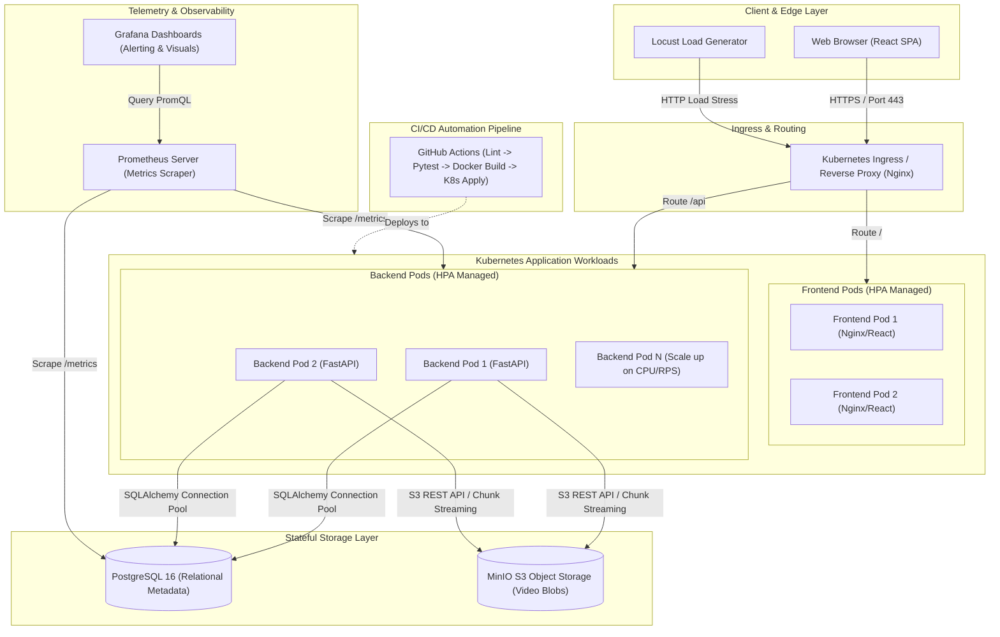

# System Architecture - DevOps Video Streaming Platform

## Overview

The DevOps Video Streaming Platform is designed as an enterprise-grade cloud-native streaming and content management architecture. It demonstrates complete DevOps lifecycle patterns: containerization, microservice communication, declarative infrastructure, automated self-healing, horizontal pod autoscaling (HPA), zero-downtime rolling deployments, and unified telemetry.

---

## High-Level Architecture Diagram

---

## Architectural Components

### 1. Frontend
* **Stack**: React 18+, Vite, TypeScript, modern CSS with responsive glassmorphism aesthetic.
* **Role**: Single Page Application (SPA) serving video catalog browsing, video playback, user authentication flows (login, registration, profile), and telemetry display.
* **Deployment**: Multi-stage Docker build served via optimized Nginx alpine container.

### 2. Backend
* **Stack**: Python 3.14 / 3.11+, FastAPI, Pydantic v2, SQLAlchemy 2.0.
* **Role**: Modular REST API handling authentication (JWT), role-based access control (RBAC: USER, ADMIN), video metadata management, streaming endpoint generation, and real-time health checks (`/live`, `/ready`).
* **Design Pattern**: Clean Layered Architecture (`routes` -> `services` -> `models` / `database` -> `core/schemas`).

### 3. PostgreSQL
* **Role**: Relational database handling structured transactional entities:
  * `User`: Credentials, hashed passwords (bcrypt), system roles.
  * `Video`: Metadata, duration, storage references, category, viewer counters.
  * `VideoView`: Analytics audit trail, watcher IP, timestamp indexes.
* **Resilience**: Connection pooling, indexed foreign keys, automated schema migrations.

### 4. MinIO Object Storage
* **Role**: High-performance, S3-compatible distributed object storage for video MP4/HLS blobs and thumbnails.
* **Capabilities**: Multipart upload, presigned secure streaming URLs, bucket policies, and high I/O throughput.

### 5. Docker
* **Role**: Containerization standard ensuring identical local and cloud environments.
* **Features**: Multi-stage builds, non-root user execution, minimal attack surface (Alpine/Slim base images), and docker-compose service mesh for local developer velocity.

### 6. Kubernetes (K8s)
* **Role**: Declarative container orchestration engine.
* **Manifests**:
  * `Deployments`: Declarative workload specs with replica control.
  * `Services`: ClusterIP abstraction for reliable internal DNS service discovery.
  * `ConfigMaps & Secrets`: Decoupling configuration and sensitive credentials from code.
  * `Ingress`: Edge routing rules matching path prefixes (`/` and `/api`).

### 7. CI/CD (GitHub Actions)
* **Continuous Integration**:
  1. Automated linting (flake8/black, eslint).
  2. Test execution (Pytest with coverage, Vitest).
  3. Security vulnerability auditing.
* **Continuous Delivery**:
  1. Docker container image build and tag.
  2. Image push to container registry.
  3. K8s deployment rollout validation.

### 8. Prometheus Monitoring
* **Role**: Time-series metrics collection via pull model.
* **Scrape Targets**: FastAPI backend `/metrics` endpoint, Postgres exporter, and node metrics.
* **Key Metrics**: HTTP request count by status code, request duration histograms (p95, p99 latency), database pool saturation, active stream connections.

### 9. Grafana
* **Role**: Unified operations dashboard for site reliability engineering (SRE).
* **Dashboards**: System throughput (RPS), error rates (4xx/5xx), API p99 response times, resource consumption, and business metrics (video views/sec).

### 10. Horizontal Pod Autoscaler (HPA)
* **Mechanism**: Kubernetes metrics-server integration dynamically scaling backend and frontend pods based on target CPU utilization (e.g. 70%) or custom request-rate metrics.
* **Scaling Range**: Min 2 replicas (high availability) to Max 10 replicas (traffic burst absorption).

### 11. Load Balancing
* **Ingress Controller**: Distributes ingress traffic across healthy service endpoints.
* **Service Level**: Kube-proxy iptables/IPVS round-robin routing between active pod IPs.

### 12. Self-Healing & Fault Tolerance
* **Liveness Probes** (`/api/health/live`): Automatically restarts deadlocked or crashed containers.
* **Readiness Probes** (`/api/health/ready`): Removes unhealthy pods (e.g. DB connection lost) from the load balancer pool without killing the process, preventing user-facing 502 errors.
* **Rolling Updates**: Zero-downtime deployments with `maxSurge: 25%` and `maxUnavailable: 0`.
